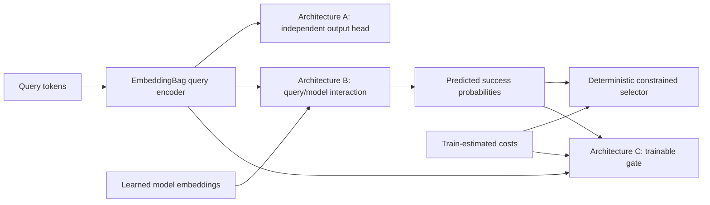

# Neural Architectures

All models use trainable hashed word embeddings (20,000 buckets), no pretrained downloads, and no
benchmark identity as an inference feature.

The quality models minimize query-balanced masked loss
`L_q = |M_q|^-1 sum_m BCE(y_qm, p_qm)`. The deterministic control selects
`argmax_m p_qm - lambda c_m`; C learns policy logits from query state, `p_q`, and `c`.

## Architecture A — Sparse Neural Router

An `EmbeddingBag(mean)` maps query tokens to a 32-dimensional vector. A 64-unit ReLU MLP with 0.1
dropout emits one success logit per model. This is a shared encoder with independent output weights,
but no learned model representation. It is a standard neural baseline, not a novelty claim.

## Architecture B — Shared Query Encoder and Model Embeddings

The same query encoder is paired with one learned 32-dimensional embedding per candidate model.
For each query/model pair, an MLP scores `[h_q, e_m, h_q * e_m]`. It cannot generalize to unseen
model IDs. Compared with A, it tests whether explicit shared model representations help.

## Architecture C — Trainable Quality-Constrained Gate

Architecture B is frozen after quality training. A separate trainable MLP receives the query
representation, all predicted model probabilities, and train-estimated normalized costs. It is
trained by cross-entropy toward the model maximizing observed train quality minus `lambda * cost`.
Thus C is a learned PyTorch policy, not a deterministic decision layer.

The control is a deterministic selector using the same calibrated B predictions:

`argmax_m p_B(success | q,m) - lambda * expected_cost_m`.

This isolates whether the trainable gate improves over direct constrained selection.
